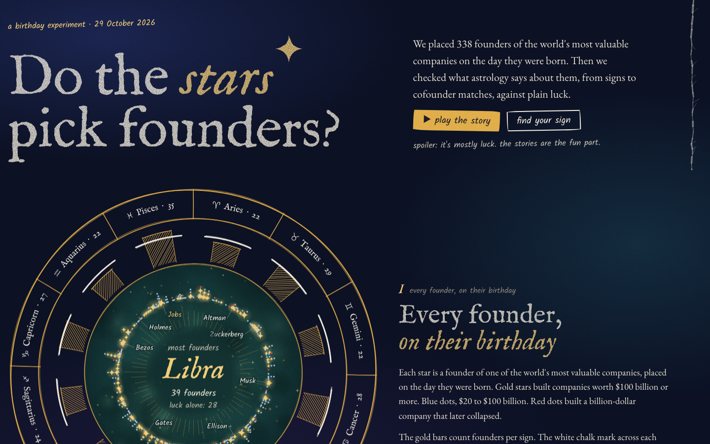
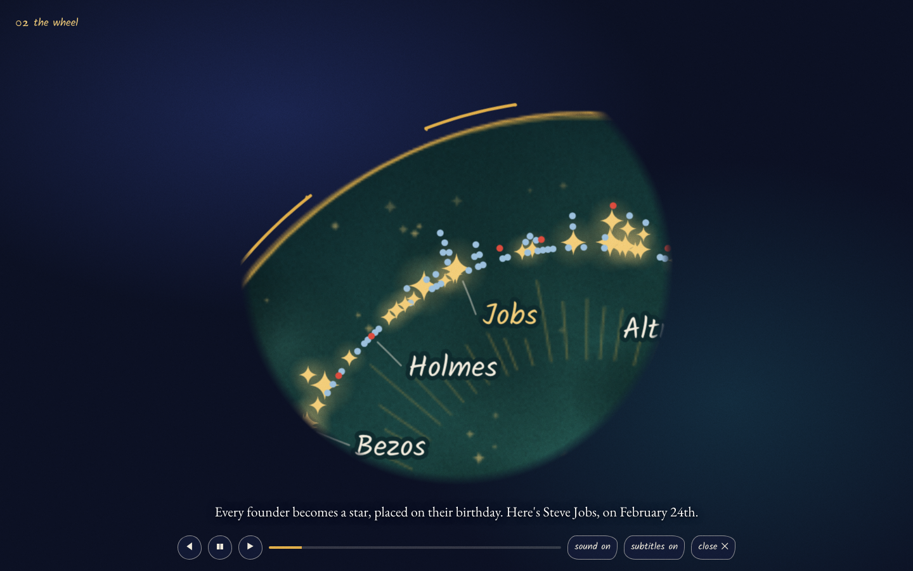
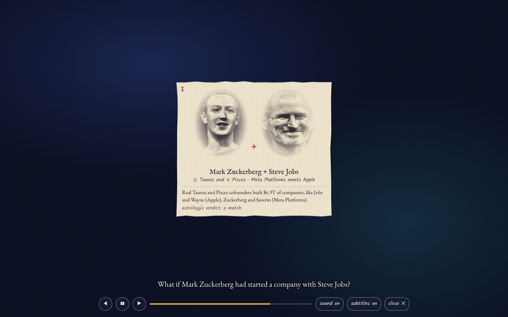

# Founders by birthday






An interactive single-page data story: every founder of the world's biggest companies on one 365-day ring. Do they cluster by zodiac sign, month, or cofounder pairing, and does any pattern survive contact with chance?

- `dist/index.html` is self-contained (data inlined, no build step; only the Google Fonts stylesheet loads from the network, with system-font fallbacks). Open it locally or serve `dist/` on GitHub Pages. `dist/artifact.html` is the same page without the document skeleton, for publishing as a claude.ai artifact.
- Link straight to a chapter with its id, for example `#chart` (the match chart), `#school` or `#you`. Add `?still` to skip the opening animation (used for screenshots).
- The page opens with a narrated film (about 4 minutes): "watch the film" plays it full screen with voice and subtitles. `VIDEO_SCRIPT.md` is its script, generated from the stats by `pipeline/14_film.py`. Add `?film=12` to the address to open the film at line 12 (with `&still` it stays paused there).
- `HYPOTHESES.md` was committed before any birth date was pulled. Anything not in it is labelled "exploratory" on the page.
- `SCOPE.md` explains the universe: companies founded 1960 to 2023 in three rings (Giants $100B+, Big $20B to $100B, Fallen).

## Pipeline

All scripts live in `pipeline/` and cache every raw API response under `cache/`, so reruns are reproducible and offline once cached.

```bash
export PYTHONPATH=pipeline
P=~/.venvs/founders/bin/python     # pyswisseph, requests, numpy, scipy
$P -P pipeline/01_companies.py     # candidates: market-cap ranking + private board  -> data/candidates.json
$P -P pipeline/02_wikipedia.py     # Wikipedia article, infobox founders, Wikidata P112 -> data/companies_raw.json
$P -P pipeline/02b_rings.py        # rings, exclusions, fallen companies            -> data/companies.json, companies.csv
$P -P pipeline/03_founders.py      # founder roster with Wikidata IDs               -> data/founders_raw.json
$P -P pipeline/04_birthdays.py     # day-precision birthdays with source URLs       -> data/founders.json
$P -P pipeline/05_moon.py          # Moon sign candidates (exploratory)             -> data/moon.json
$P -P pipeline/06_baseline.py      # birth seasonality by country and year          -> data/baseline.json
$P -P pipeline/09_rising.py        # Rising sign where Astro-Databank has a time    -> data/rising.json
$P -P pipeline/12_sectors.py       # company type from the Wikipedia industry line  -> data/sectors.json
$P -P pipeline/07_stats.py         # the pre-registered tests and labelled extras   -> data/stats.json
$P -P pipeline/08_build.py         # inline everything                              -> dist/index.html, dist/artifact.html
$P -P pipeline/15_extras.py        # founding ages, age gaps, birthday twins, the clash finding sliced, sign traits -> data/extras.json
$P -P pipeline/13_whatif.py        # ten what-if cofounders, imagined companies (pipeline/whatif_ideas.json), portraits -> data/whatif.json, data/portraits.json
PYTHONPATH=pipeline ~/.venvs/tts/bin/python -P pipeline/14_film.py   # film narration, voiced with Kokoro -> data/film.json, VIDEO_SCRIPT.md
$P -P pipeline/16_faces.py         # faces for the team builder, death years (Wikidata P570) -> data/faces.json, data/deaths.json
$P -P pipeline/08_build.py         # build again so the page carries the film and portraits
$P -P tests/team_builder_check.py  # every founder pair, the live Claude button (faked), coming back to the chapter
```

The portrait steps share `pipeline/portraits.py`. The small faces are found with OpenCV's YuNet face detector (downloaded once from the official opencv_zoo to `~/.cache/opencv/`), because the older Haar detector took a shirt, an ear or a blur for a face on a few photos. The check in `tests/` needs Playwright (`pip install playwright`, then `python -m playwright install chromium`).

`pipeline/name_fixes.json` corrects three names Wikidata got wrong when we pulled it (one vandalised label, one typo, one disambiguation tag), each with its reason and source. `pipeline/overrides.json` (optional) fixes an article pick, a founding year, or a founder list for a named company, or excludes it with a reason. Tesla lists all five people its 2009 settlement lets call themselves cofounders, with the Wikipedia sentence quoted in the note.

## Changes after the first build (29 October 2026)

- Breakups: the matcher now reads every name in a row ("Peter Thiel; Max Levchin", "Evan Williams (with Jack Dorsey)") and matches pairs within the row's company. Before, rows naming more than one person per side were dropped, which is why only 6 pairs counted. The pre-registered test ("broke up" rows) now has 8 pairs; the page also shows the wider set that includes board ousters (13 pairs), labelled as such. Most famous splits (Twitter, Snap, Tinder, Yahoo, Groupon) are at companies outside the list.
- Company type by sign: new exploratory test (`12_sectors.py`, `T["sectors"]`), shuffling company types between companies 10,000 times.
- The page was rewritten in plain words, with the match chart (click to hold a square), a your-sign view, famous pairs, and a share card.
- "Luck" was replaced by a comparison with everyone else; random birthdays became a random crowd of ordinary people.
- New founder-value analysis (`T["value"]`): which signs and sign pairs built the most, and whether matched teams built bigger companies (one vote per company, team-shuffle null). Clashing teams came out ahead ($105B vs $55B median, about 1 in 17 by chance), reported as a lead, not a finding.
- Ten what-if cofounders (`13_whatif.py`), ranked by that value data, with portraits from Wikimedia Commons.
- A narrated film (`14_film.py`) replaced the old Play the story.
- Founder-first rewrite: "fair share" instead of "born like everyone else", the coin-flip framing for matches, the clash finding sliced by era, industry, team size and without OpenAI (`15_extras.py`), the money map as the default chart, a team simulator (with a live "invent their company" button that asks Claude when the page runs as a claude.ai artifact), astrology's sign traits checked against the data, founding ages, and birthday twins. Null results moved to one paragraph under How we did it.
- The team builder, rebuilt: faces and search instead of two long dropdowns, a "surprise me" spin, real teams marked (Jobs + Wozniak shows Apple), a stamp with astrology's verdict in plain words, and a replay of the team's company 100 times. Each replay borrows the fate of one real founding team with the same verdict, weighted toward the same industry, elements, age gap and era, then sorts the 100 futures into jars from "collapsed" to "$1T or more" and shows what flipping the verdict would do. The imagined company gets a drawn logo, a founding year when both founders were adults and alive (or a time machine when they never overlapped), a "what you're best at" box when you're on the team, and a card to save. Asking Claude waits for the viewer to allow it before the 45-second clock starts, and is guarded against stale answers, rate limits and Claude being switched off. Checked in the real claude.ai viewer: the permission box, a live answer, the card and its save prompt.
- "Fair share" became "an even split", always shown with its math (317 founders ÷ 12 signs, about 26 per sign), and the last "born like everyone else" and "everyone else: 26" labels went with it. The signs chapter and the film now say what Libra's 10 extra means: give 317 random people random birthdays and the top sign lands that far ahead about 4 times in 10. The film's chapter label follows the scene when you step back.

## Sources

- Market caps: companiesmarketcap.com, 2026-10-29. Private valuations: Crunchbase Unicorn Board (2026-10-28), multiples.vc (2026-10-23).
- Founders: English Wikipedia company infobox, unioned with Wikidata "founded by" (P112), humans only.
- Birthdays: Wikidata P569 at day precision, else the person's Wikipedia infobox; URL stored on every row. Never from memory.
- Birth seasonality: Human Fertility Database monthly births via Our World in Data.
- School cutoffs, fallen companies, breakups: `research/*.csv`, each row with a source URL.
- Birth times: Astro-Databank (astro.com), Rodden-rated, read page by page; only used when its date matches ours.

## Licences of the data and images

- Code: MIT (see LICENSE).
- Wikidata facts (birthdays, founders, places): CC0.
- Wikipedia: only facts and article links are stored (CC BY-SA 4.0 for the articles themselves).
- Birth seasonality: Our World in Data's mirror of the Human Fertility Database, CC BY 4.0.
- Market values: companiesmarketcap.com and the Crunchbase Unicorn Board, with the source on every row of companies.csv.
- Birth times: Astro-Databank (astro.com), facts only (date, time, place, Rodden rating).
- Founder portraits in data/whatif.json, data/portraits.json and data/faces.json are redrawn from photos on Wikimedia Commons. Each keeps its own licence (CC BY, CC BY-SA or public domain); the photographer, licence and file page are listed beside each portrait and on the page under "portrait credits".
- Narration audio is generated with Kokoro-82M (Apache 2.0).
